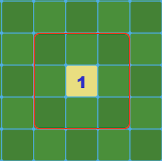
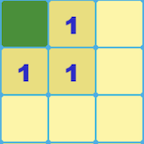
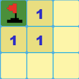
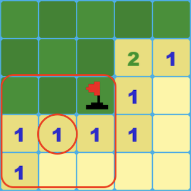
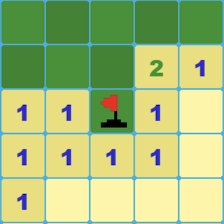

<div align="center">


</div>

💣 **Саперность** 🚩 - Классический сапер с уникальным дизайном, написанный на языке **Python** с использованием библиотеки **PyGame**. 

*На выбор представлены три сложности - Легкая, Средняя и Сложная, имеется таймер прохождения поля, а также экраны победы и проигрыша*

**Автор** - <a href="https://github.com/dryomaly">dryomaly</a>

<div align="center">

# **Содержание**
 [Возможности](#1-возможности)

 [Установка и запуск](#2-установка-и-запуск)

 [Как играть?](#3-как-играть)

 [Структура проекта](#4-структура-проекта)

</div>

# **1. Возможности**
- Отрисовка главного экрана с логотипом игры "Саперность"
- Три кнопки на главном экране("Играть", "Настройки", "Выход")
- Открытие клеток при нажатии ЛКМ
- Постановка флажков при нажатии ПКМ
- Цифры на клетках, показывающие количество мин вокруг
- Цвета цифр соответствуют цветам цифр оригинального сапера
- Открытие пустых клеток рекурсивным методом open_empty_cells()
- Расстановка мин всегда происходит в случайном порядке
- Проигрыш и остановка текущей игры при нажатии на мину 
- Победа и остановка текущей игры при открытии всех безопасных клеток
- Возможность начать играть снова после победы или проигрыша - кнопка "новая игра"
- Экраны победы и проигрыша
- Секундомер, запускающийся после первого нажатия на поле
- Уникальный дизайн поля

# **2. Установка и запуск**
Для работы кода при развертывании потребуется Python ≥ 3.13.12 
Так же нужно установить бибилиотеку PyGame:
### Windows
```
pip install pygame
```
### MacOS
```
pip3 install pygame
```
*Далее открываем **терминал** в вашей IDE или же через встроенный терминал, пишем команду **для запуска** исполняемого файла:*
### Windows
```
python main.py 
```
### MacOS
```
python3 main.py
```

# **3. Как играть?**
Проделав несложные махинации, описанные в блоке выше, вы попадаете в главное меню игры **"Саперность"**. Перед вами будут четыре кнопки: **ИГРАТЬ**, **СЕЛЕКТОР СЛОЖНОСТИ**, **НАСТРОЙКИ** и **ВЫЙТИ**.

1) Выберите желаемую сложность и нажмите на **ИГРАТЬ** чтобы попасть на игровое поле. Перед собой вы увидите классическое закрытое игровое поле с минами, кнопку "**< Меню**", а также таймер, который запустится как только вы откроете первую клетку.

2) Нажмите в любую из клеток Левой Кнопкой Мыши чтобы открыть эту клетку, в игре так же представлена возможность постановки флага на клетку(ПКМ), дабы обезопасить себя от случайного нажатия на нее и для последующего подсчета мин (при правильной расстановке флагов конечно же :D).

3) После первого нажатия на клетку с цифрой от 1 до 9
    * вы увидите цифры на клетках - они означают количество мин вокруг самой клетки внутри ее квадрата 3x3, цифра "1" в примере означает, что в красном квадрате вокруг цифры находится ровно ОДНА мина, может быть она где угодно в рамках этого квадрата:

        
    * для каждой клетки представляйте мысленно ее квадрат 3x3. Если в этом квадрате только одна закрытая клетка, то именно там и будет находиться мина (эта логика распространяется и на остальные цифры: цифра два и только две закрытые клетки - мины именно там и так далее):

        
        

    * рассмотрим стоящую слева **единицу** - в ее воображаемом квадрате уже стоит **флаг(мина)**, следовательно остальные клетки в ее квадрате **безопасны** и их смело можно открывать:

        

        

    * Продолжаем открывать мины дальше и ведем себя к финалу игры!
Вы можете довести игру до логического финала - открытие всех безопасных клеток или же подрыв на одной из мин, что соответственно приведет к победе или же к проигрышу.

 После финала перед вами появится экран окончания игры с кнопкой **НОВАЯ ИГРА** с возможностью начать новую игру с новым уникальным полем
# **4. Структура проекта**
